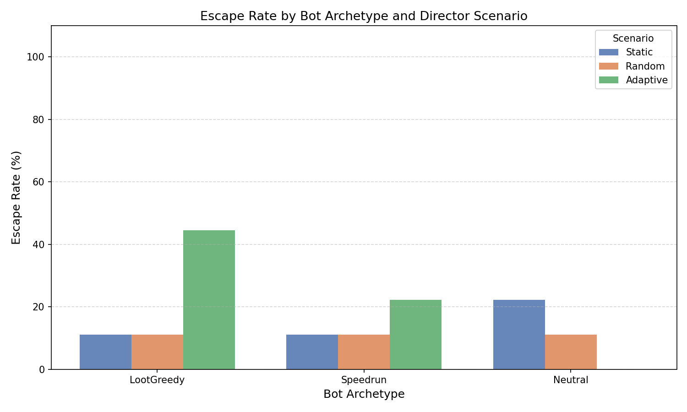
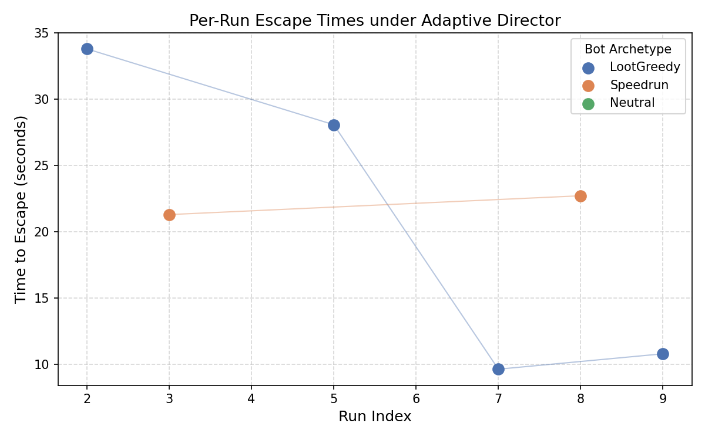

# Adaptive Level Generation via Player Modeling in Adversarial Environments

Final Year Project, BSc Computer Science, University of Surrey (2026) — **66%**

A Unity 2D system that procedurally generates dungeon levels and adapts an in-game "director" AI's difficulty in real time based on how a player actually behaves, rather than applying static or random difficulty. Three heuristic bot archetypes (LootGreedy, Speedrunner, Neutral) act as automated playtesters, evaluated over 81 automated runs across three director configurations.

## Key result

The adaptive, telemetry-informed director produced clearly playstyle-sensitive outcomes that a static or random director could not: the exploratory **LootGreedy** archetype's escape rate rose **4x** (11% → 44%), while the repetitive-routing **Neutral** archetype was fully suppressed (22% → 0%).

<p align="center">
  
  
</p>

## How it works

- **Procedural level generation** — rooms are placed randomly within a spawn radius, iteratively pushed apart to resolve overlaps, then connected with a Minimum Spanning Tree with a portion of rejected Delaunay edges reintroduced as cycles, avoiding the purely linear layouts a pure MST produces.
- **Director AI** — a persistent `DirectorManager` builds a per-run heatmap of door/window usage plus a session-long "global tendency" of the player's broad interactable preferences, and spends a pre-match budget (earned from previous escapes) to block frequently-used interactables or boost the hunter's speed.
- **Hunter AI** — a utility-based agent that weighs chase utility (distance + line-of-sight) against sabotage utility (heatmap heat ÷ distance to target) every decision tick, and pathfinds via Unity's NavMesh.
- **Player archetypes** — three `BotController` subclasses (LootGreedy, Speedrunner, Neutral) with distinct loot-collection and escape logic, used as automated, repeatable playtesters instead of human trials.
- **Automated evaluation harness** — a `TestingFramework` component runs all 9 scenario × archetype combinations automatically and exports results to CSV, from which `generate_graphs.py` produces the result charts above.

## Tech stack

Unity 6 (2D URP) · C# · NavMeshPlus · Unity New Input System · Python (matplotlib, for result graphs)

## Project structure

```
Assets/_Project/
├── Scripts/
│   ├── PCG/          # Room-first level generator, MST connectivity, loot spawning
│   ├── AI/           # Hunter AI, bot archetypes, automated testing framework
│   ├── Managers/      # DirectorManager, GameManager, PlayerController
│   └── Interfaces/    # Doors, windows, corridor/room wall generation
├── Prefabs/
├── Art/
└── Scenes/
Assets/generate_graphs.py   # Turns TestResults.csv into the charts above
Assets/TestResults.csv      # Raw output of the 81-run automated evaluation
```

## Running it

1. Install Unity Hub and Unity Editor **6000.3.10f1**.
2. In Unity Hub: *Add → Add project from disk* and select this folder.
3. Open the project — Unity regenerates the `Library` folder on first load (a few minutes).
4. Open `Assets/_Project/Scenes/SampleScene` and press Play to run the game manually.
5. To reproduce the automated evaluation: select the `TestingFramework` GameObject, check *Run Tests* in the Inspector, then press Play. Results export to `Assets/TestResults.csv`; run `generate_graphs.py` from `Assets/` to regenerate the charts.

## Limitations & future work

The bot archetypes are heuristic (fixed decision rules) rather than trained agents, so they can't adapt their own policy in response to the director. A full Deep Q-Network agent architecture — observation/action space, reward shaping, and hyperparameters — is designed and specified as the primary next step (see the dissertation), alongside fixed-seed level generation to allow behavioural comparison in a geometrically controlled environment.

## Full writeup

The complete dissertation — literature review, system design, and full experimental analysis — is available on request.
